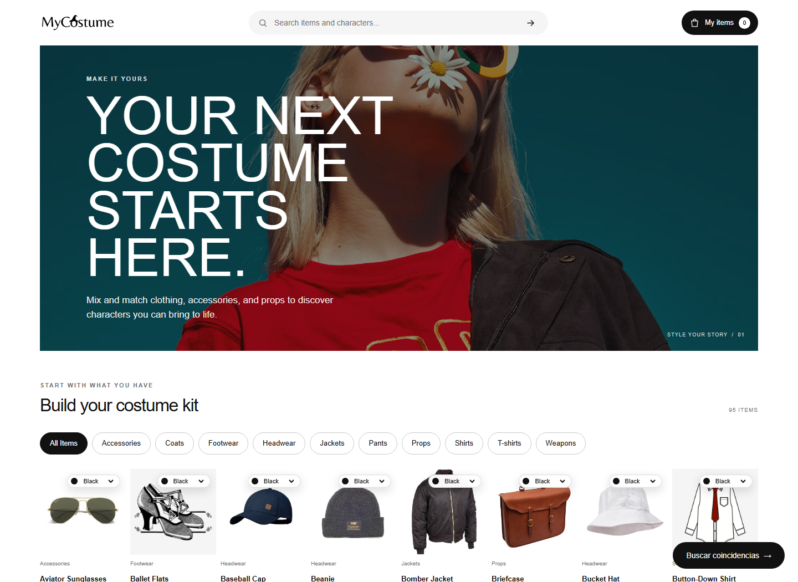
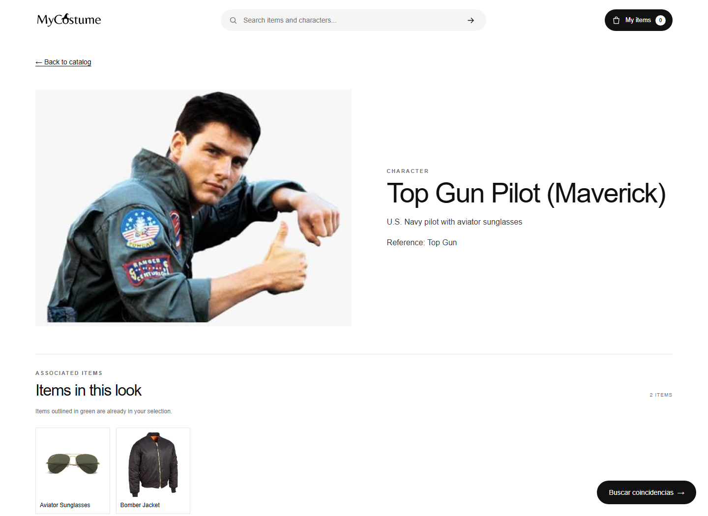

  

<table align="center">
  <tr>
    <td bgcolor="#111111">
      
    </td>
    <td><strong>Build a look. Discover a character.</strong></td>
  </tr>
</table>

# Welcome to MyCostume

MyCostume helps you turn pieces from your wardrobe into costume inspiration. Browse clothing, accessories, footwear, and props, then discover characters connected to the items you choose.

No account needed. Your outfit selection stays in your browser.

## How it works

1. **Explore** the catalog or search for something specific.
2. **Build your look** by choosing items and colors.
3. **Get inspired** by character ideas and see the pieces associated with each one.

## Take a look

### Browse the catalog

### Explore a character look

## Built with

- **React, JavaScript, Vite, and CSS** for the web experience.
- **Node.js and Express** for the application service.
- **MySQL** for the costume and item catalog.
